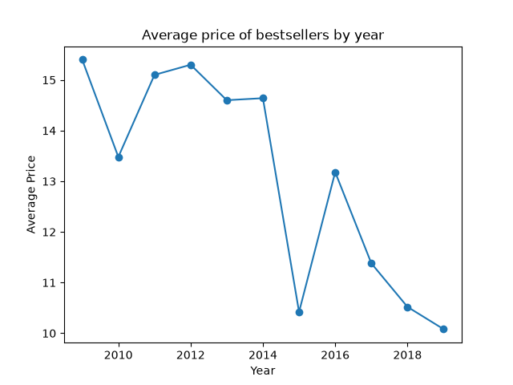
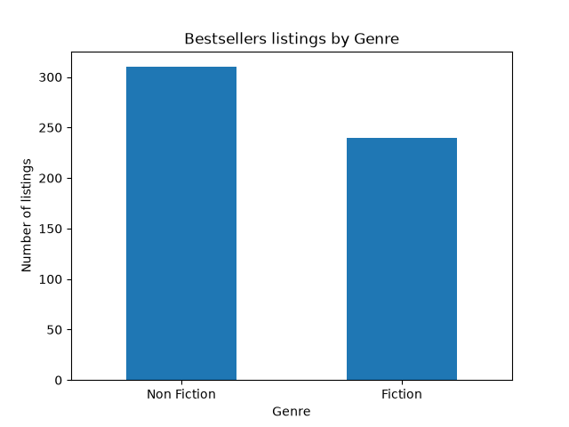
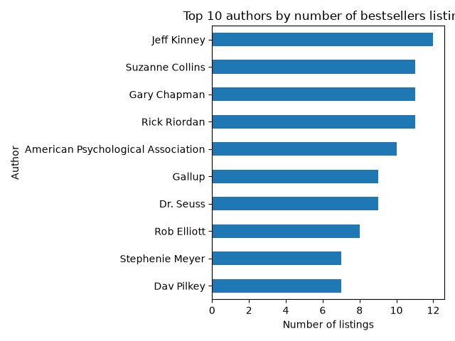
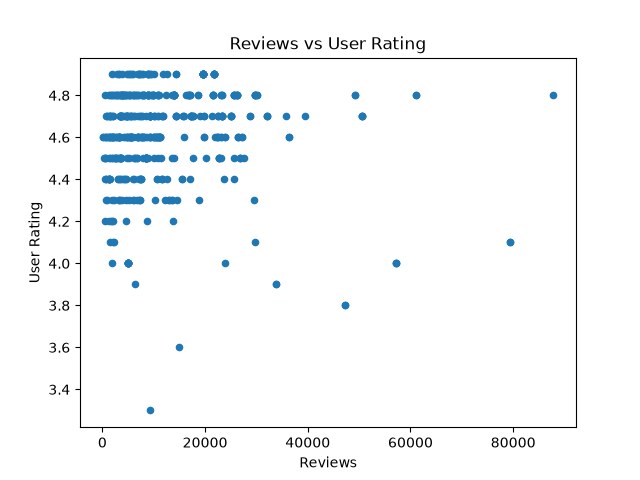

# Amazon Bestsellers Analysis

I analysed data on Amazon's top 50 bestselling books for each year from 2009 to 2019. I used Python, Pandas and Matplotlib.

## The data
I used the Amazon Top 50 Bestselling Books 2009 - 2019 dataset from Kaggle. It has 550 rows (one for each book on a yearly list) and 351 different book titles. Each row has the name, author, rating, number of reviews, price, year and genre.

## Questions I looked at
1. How many bestsellers are Fiction and how many are Non Fiction?
2. How did the average price change over the years?
3. Which authors appear most often?
4. Do books with more reviews get higher ratings?

## What I found
- 310 of the 550 listings are Non Fiction and 240 are Fiction.
- The average price went down from $15.40 in 2009 to $10.08 in 2019.
- Fiction books were rated slightly higher on average (4.65 compared with 4.60), but the difference is small.
- Some books were bestsellers for many years. The APA Publication Manual appeared 10 times and StrengthsFinder 2.0 appeared 9 times.
- The number of reviews has no clear link to the rating.

## Charts

## Things to keep in mind
- The same book can appear in more than one year, so it is counted each time.
- 12 books have a price of 0. They are probably free or promotional.
- Most ratings are between 4.5 and 4.8, so small differences do not mean much.

## How to run it
1. Install the libraries: `pip install pandas matplotlib jupyter`
2. Open `analysis.ipynb` in VS Code and run all the cells.

## What I learned
I learned how to load a CSV, group the data and make charts. The hardest part was setting up Git.